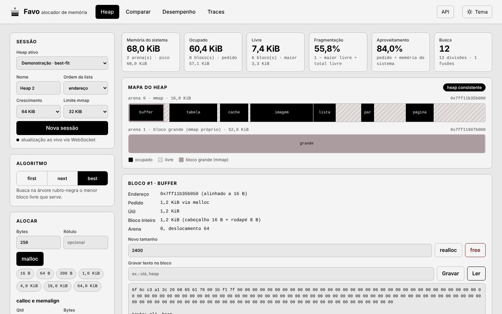
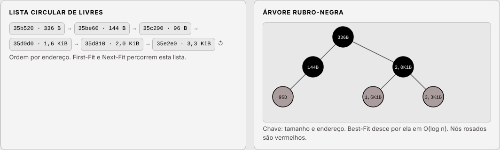
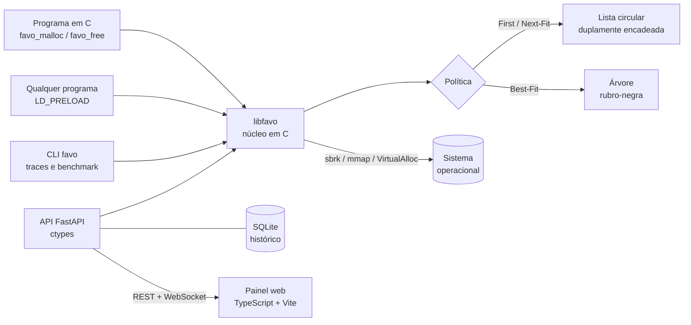
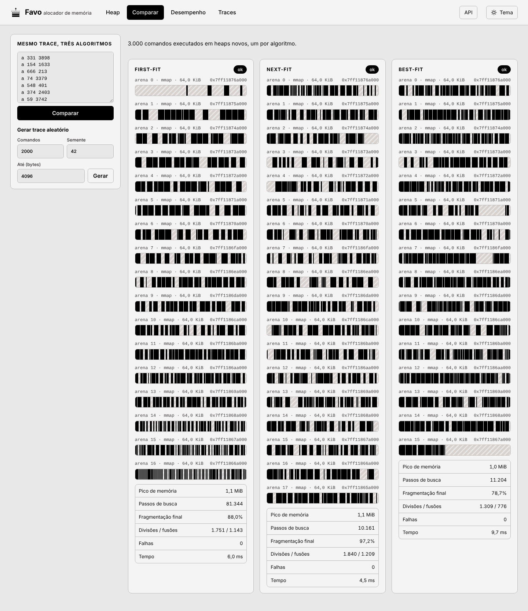

<p align="center">
  
</p>

<h1 align="center">Favo<br><sub><sup><sup><sub>Copyright (©) 2026 Erik Pimenta</sub></sup></sup></sub></h1>

<p align="center">
  Alocador de memória escrito em C que substitui o <code>malloc</code> e o <code>free</code> do sistema: pede blocos grandes ao sistema operacional com <code>sbrk</code> e <code>mmap</code>, subdivide em pedaços alinhados a 16 bytes, encontra espaço com First-Fit, Next-Fit ou Best-Fit e funde blocos vizinhos livres para conter a fragmentação.<br>
  Pronto para usar, estudar ou adaptar.
</p>

<p align="center">
  C11 · sbrk · mmap · VirtualAlloc · pthreads · CMake · LD_PRELOAD · Python 3.13 · FastAPI · WebSocket · SQLite · TypeScript · Vite · Docker
</p>

---

> **Manual completo:** [`Manual-Favo.pdf`](Manual-Favo.pdf) explica como a memória é organizada por dentro, a instalação no Linux e no Windows, a API em C, o LD_PRELOAD, a linha de comando, cada tela do painel, a API REST, a configuração, como estender o projeto, os testes e a solução de problemas, passo a passo (cópia em [`docs/`](docs/Manual-Favo.pdf)).

> **Banco de dados:** [`Banco-de-Dados-Favo.pdf`](Banco-de-Dados-Favo.pdf) traz o diagrama de relacionamentos, todas as tabelas com campos, tipos, chaves e restrições, as migrações, as consultas usadas pela API e como fazer backup do SQLite.

<p align="center">
  
</p>

## O que o Favo faz

- **Heap próprio sobre o sistema operacional:** pede regiões ao kernel com `sbrk` (crescendo o program break) ou `mmap` anônimo, e com `VirtualAlloc` no Windows. Quando o break cresce de forma contígua, a arena é estendida e o novo espaço se funde ao último bloco livre.
- **Blocos com cabeçalho e rodapé:** cada bloco tem um cabeçalho de 16 bytes (tamanho, estado e assinatura) e um rodapé de 8 bytes com o mesmo tamanho (boundary tags). O payload sai sempre alinhado a 16 bytes, e o bloco mínimo tem 64 bytes.
- **Três algoritmos de alocação:** **First-Fit** e **Next-Fit** percorrem uma **lista circular duplamente encadeada** ordenada por endereço (ou LIFO). **Best-Fit** desce por uma **árvore rubro-negra** ordenada por tamanho e endereço em O(log n). A política pode ser trocada com o heap em uso.
- **Divisão e fusão:** um bloco maior que o pedido é dividido e a sobra volta para as estruturas. No `free`, o bloco se funde em O(1) com os vizinhos livres da esquerda e da direita (coalescing), olhando o rodapé do anterior e o cabeçalho do seguinte.
- **API completa:** `malloc`, `free`, `calloc`, `realloc` (cresce no lugar quando o vizinho está livre), `memalign`, `posix_memalign`, `aligned_alloc`, `valloc`, `pvalloc` e `malloc_usable_size`, além de `malloc_trim` e `malloc_stats` no `LD_PRELOAD`.
- **Blocos grandes direto do sistema:** pedidos acima do limite configurável ganham um `mmap` próprio e voltam ao sistema no `free`. Arenas totalmente livres são devolvidas, e o topo do `sbrk` encolhe com `trim`.
- **Segurança:** detecta double free, ponteiro de fora do heap, ponteiro do meio de um bloco e escrita além do fim do bloco (rodapé corrompido). Um verificador percorre arenas, lista e árvore e confere cada invariante.
- **Seguro com threads:** cada heap tem o seu lock, e a versão com `LD_PRELOAD` trata `fork` sem deixar o lock preso no processo filho.
- **Substitui o malloc de qualquer programa:** com `LD_PRELOAD=libfavo_preload.so`, `bash`, `python3` e qualquer binário dinâmico passam a usar o Favo.
- **Ferramentas:** linha de comando para rodar traces de alocação, comparar algoritmos e medir desempenho contra o malloc do sistema. API REST com WebSocket e um painel web que mostra o heap bloco a bloco, a lista de livres e a árvore rubro-negra ao vivo.

<p align="center">
  
</p>

## Arquitetura



### Como um bloco é organizado

```
arena (pedida ao sistema)
┌────────────┬─────────┬──────────────────────────────┬─────────┬─────┬──────────┐
│ cabeçalho  │ prólogo │ bloco 1                      │ bloco 2 │ ... │ epílogo  │
│ da arena   │  8 B    │                              │         │     │  16 B    │
└────────────┴─────────┴──────────────────────────────┴─────────┴─────┴──────────┘

bloco ocupado                               bloco livre
┌──────────────────────┐ ← 16 B             ┌──────────────────────┐
│ tamanho | flags      │   cabeçalho        │ tamanho | flags      │
│ assinatura | pedido  │                    │ assinatura           │
├──────────────────────┤ ← ponteiro         ├──────────────────────┤
│                      │   devolvido        │ próximo / anterior   │ lista circular
│ dados do usuário     │   (alinhado a 16)  │ esquerda / direita   │ árvore
│                      │                    │ pai + cor            │ rubro-negra
├──────────────────────┤                    ├──────────────────────┤
│ tamanho | flags      │ ← rodapé 8 B       │ tamanho | flags      │
└──────────────────────┘                    └──────────────────────┘
```

| Parte | Arquivo | Responsabilidade |
|---|---|---|
| Sistema | `src/os.c` | `sbrk`, `mmap`/`munmap`, `VirtualAlloc`/`VirtualFree`, locks |
| Núcleo | `src/heap.c` | Arenas, busca, divisão, fusão, `realloc`, `memalign`, blocos grandes, `trim` |
| Lista livre | `src/list.c` | Lista circular duplamente encadeada por endereço ou LIFO |
| Árvore | `src/rbtree.c` | Árvore rubro-negra por (tamanho, endereço) com busca do menor bloco que serve |
| Inspeção | `src/inspect.c` | Estatísticas, mapa de blocos, lista, árvore e verificador de integridade |
| Heap global | `src/global.c` | `favo_malloc` e companhia, configuração por variáveis de ambiente |
| Substituição | `src/preload.c` | Exporta `malloc`, `free` e os demais símbolos para o `LD_PRELOAD` |
| Benchmark | `src/bench.c` | Carga aleatória medida em C, com o malloc do sistema como referência |

## Como rodar

Com **Docker** (Windows, Linux ou macOS):

**Windows:** dê dois cliques em `iniciar.cmd`.

**Linux ou macOS:**

```bash
bash iniciar.sh --docker
```

O painel abre em **http://127.0.0.1:8080**.

| Endereço | O que é |
|---|---|
| http://127.0.0.1:8080 | Painel |
| http://127.0.0.1:8080/docs | Documentação da API (Swagger) |
| http://127.0.0.1:8080/openapi.json | Esquema OpenAPI |

Sem Docker, no Linux ou macOS (precisa de CMake, um compilador C, Python 3.10+ e Node.js 20+):

```bash
bash iniciar.sh
```

Só a biblioteca e as ferramentas:

```bash
cmake -S . -B build -DCMAKE_BUILD_TYPE=Release
cmake --build build -j
cd build && ctest --output-on-failure
sudo cmake --install build
```

No Windows, a biblioteca compila com o Visual Studio 2022 ou com o MSYS2 (`cmake -S . -B build && cmake --build build --config Release`). O `LD_PRELOAD` e o `sbrk` existem só no Linux; no Windows o Favo usa `VirtualAlloc`.

## Usando como biblioteca em C

```c
#include <favo.h>

int main(void)
{
    favo_config cfg;
    favo_config_default(&cfg);
    cfg.policy = FAVO_BEST_FIT;

    favo_heap *heap = favo_heap_create(&cfg);
    char *texto = favo_heap_alloc(heap, 64);
    double *v = favo_heap_calloc(heap, 100, sizeof(double));
    texto = favo_heap_realloc(heap, texto, 4096);

    favo_stats s;
    favo_heap_stats(heap, &s);

    char erro[256];
    if (favo_heap_check(heap, erro, sizeof(erro)) != FAVO_OK)
        return 1;

    favo_heap_free(heap, v);
    favo_heap_free(heap, texto);
    favo_heap_destroy(heap);
    return 0;
}
```

```bash
cc programa.c -I include -L build -lfavo_static -lpthread -o programa
```

Para usar o heap global, chame `favo_malloc`, `favo_free`, `favo_calloc`, `favo_realloc` e `favo_memalign`.

## Substituindo o malloc de qualquer programa

```bash
LD_PRELOAD=./build/libfavo_preload.so python3 -c "print(sum(range(10**6)))"
FAVO_POLICY=best FAVO_STATS=1 LD_PRELOAD=./build/libfavo_preload.so bash -c "ls / > /dev/null"
```

| Variável | Valores | Padrão |
|---|---|---|
| `FAVO_POLICY` | `first`, `next`, `best` | `first` |
| `FAVO_SOURCE` | `sbrk`, `mmap` | `sbrk` no Linux |
| `FAVO_ORDER` | `address`, `lifo` | `address` |
| `FAVO_GROW` | tamanho mínimo de cada pedido ao sistema (`1M`, `256K`) | `1M` |
| `FAVO_MMAP_THRESHOLD` | a partir deste tamanho o bloco ganha `mmap` próprio (`0` desliga) | `256K` |
| `FAVO_MAX_BYTES` | limite total de memória do heap (`0` = sem limite) | `0` |
| `FAVO_ABORT` | `1` aborta em double free e heap corrompido | `1` |
| `FAVO_STATS` | `1` imprime as estatísticas no fim do programa | `0` |

As extensões da glibc `malloc_trim` e `malloc_stats` também apontam para o Favo: um programa que chama `malloc_trim(0)` devolve ao sistema o espaço livre no fim das arenas do Favo, e `malloc_stats()` imprime no stderr a mesma linha de estatísticas do `FAVO_STATS`, a qualquer momento.

## Linha de comando

```bash
./build/favo demo --policy best
./build/favo run traces/fragmentacao.trace --policy next --check --map
./build/favo compare traces/aleatorio.trace
./build/favo bench --ops 500000 --min 16 --max 4096
./build/favo gen --ops 5000 --seed 7 --out meu.trace
```

Um trace é um comando por linha:

| Comando | Efeito |
|---|---|
| `a <id> <bytes>` | `malloc` |
| `c <id> <qtd> <bytes>` | `calloc` |
| `m <id> <alinhamento> <bytes>` | `memalign` |
| `r <id> <bytes>` | `realloc` |
| `f <id>` | `free` |

<p align="center">
  
</p>

## API

A API cria sessões, e cada sessão é um heap isolado criado pela biblioteca em C. Tudo o que o painel faz passa por ela.

| Método | Rota | O que faz |
|---|---|---|
| `POST` | `/api/sessions` | Cria um heap com política, ordem da lista, crescimento, limite de `mmap` e teto de memória |
| `GET` | `/api/sessions/{id}/heap` | Arenas, blocos, lista livre, árvore, estatísticas e verificação |
| `POST` | `/api/sessions/{id}/alloc` | `malloc` com rótulo opcional |
| `POST` | `/api/sessions/{id}/calloc` | `calloc` |
| `POST` | `/api/sessions/{id}/memalign` | `memalign` |
| `POST` | `/api/sessions/{id}/realloc` | `realloc` de um bloco |
| `POST` | `/api/sessions/{id}/free` | `free` de um bloco |
| `POST` | `/api/sessions/{id}/write` | Grava texto dentro do bloco |
| `GET` | `/api/sessions/{id}/read/{bloco}` | Lê os bytes do bloco |
| `PUT` | `/api/sessions/{id}/policy` | Troca o algoritmo com o heap em uso |
| `POST` | `/api/sessions/{id}/trim` | Devolve memória livre ao sistema |
| `POST` | `/api/sessions/{id}/trace` | Executa um trace na sessão |
| `GET` | `/api/sessions/{id}/operations` | Histórico salvo no SQLite |
| `POST` | `/api/compare` | Roda um trace nos três algoritmos |
| `POST` | `/api/benchmarks` | Benchmark em C contra o malloc do sistema |
| `GET/POST/DELETE` | `/api/traces` | Traces salvos |
| `WS` | `/ws/sessions/{id}` | Estado do heap a cada mudança |

A lista completa, com exemplos, fica no Swagger em `/docs`.

## Configuração

| Variável | Padrão | Uso |
|---|---|---|
| `FAVO_LIBRARY` | procura em `build/` | Caminho da `libfavo.so` (ou `favo.dll`) |
| `FAVO_DATABASE` | `data/favo.db` | Arquivo do SQLite |
| `FAVO_WEB_DIR` | `web/dist` | Interface compilada |
| `FAVO_HOST` / `FAVO_PORT` | `127.0.0.1` / `8080` | Endereço da API |
| `FAVO_MAX_SESSIONS` | `32` | Sessões abertas ao mesmo tempo |
| `FAVO_CORS` | vazio | Origens liberadas, separadas por vírgula |

## Estrutura

```
├── include/favo.h      API pública em C
├── src/                núcleo do alocador
├── tools/              linha de comando favo
├── tests/              testes em C e scripts de teste
├── traces/             traces de exemplo
├── api/                API FastAPI com testes
├── web/                painel em TypeScript + Vite
├── docs/               manuais em PDF e imagens
├── CMakeLists.txt
├── Dockerfile
└── docker-compose.yml
```

### Como personalizar

1. **Nova política de alocação** (por exemplo Worst-Fit): acrescente a constante em `favo_policy` no `include/favo.h`, implemente a busca em `find_fit` no `src/heap.c` e inclua o nome em `favo_policy_name` (`src/global.c`) e em `POLICIES` (`api/favo_api/binding.py`).
2. **Listas segregadas por tamanho:** troque o ponteiro `list` da `struct favo_heap` por um vetor de listas e escolha a lista pelo tamanho em `favo_list_insert` e `find_fit`.
3. **Nova origem de memória** (por exemplo páginas enormes): crie a função em `src/os.c` e chame em `grow` no `src/heap.c`.
4. **Nova rota da API:** escreva a função em `api/favo_api/app.py` dentro de `create_app`; se ela mudar o heap, passe por `mutate` para registrar no SQLite e avisar o WebSocket.
5. **Nova tela:** acrescente a aba em `shell()` e a função de desenho em `web/src/main.ts`, usando os componentes de `web/src/render.ts`.

O passo a passo de cada caso, com exemplos, está no manual.

## Testes

```bash
make test        # testes em C, LD_PRELOAD e traces
make asan        # AddressSanitizer e UndefinedBehaviorSanitizer
make valgrind    # Valgrind
make api         # testes da API com pytest
```

Os testes cobrem alinhamento de todos os tamanhos de 0 a 300 bytes, `calloc` zerado, `realloc` que cresce no lugar e que move, fusão dos dois lados, cada algoritmo escolhendo o bloco certo, `memalign` até 64 KiB, blocos grandes, double free, ponteiro inválido, escrita fora do bloco, teto de memória, `trim`, 150 mil operações aleatórias com conferência de conteúdo para cada política, oito threads no mesmo heap e programas reais rodando com `LD_PRELOAD`.

O workflow [`ci.yml`](.github/workflows/ci.yml) compila com GCC e Clang, roda os testes com sanitizers e Valgrind, compila no Windows, testa a API, monta a interface e a imagem Docker.

### Componentes de terceiros

| Componente | Uso no projeto | Licença |
|---|---|---|
| [FastAPI](https://fastapi.tiangolo.com/) | API REST e WebSocket | MIT |
| [Uvicorn](https://www.uvicorn.org/) | Servidor ASGI | BSD-3-Clause |
| [SQLite](https://sqlite.org/) | Histórico de sessões, traces e benchmarks | Domínio público |
| [Vite](https://vite.dev/) | Build da interface | MIT |
| [TypeScript](https://www.typescriptlang.org/) | Linguagem da interface | Apache-2.0 |

## Licença

[MIT](LICENSE). Use, copie, altere e distribua à vontade.
